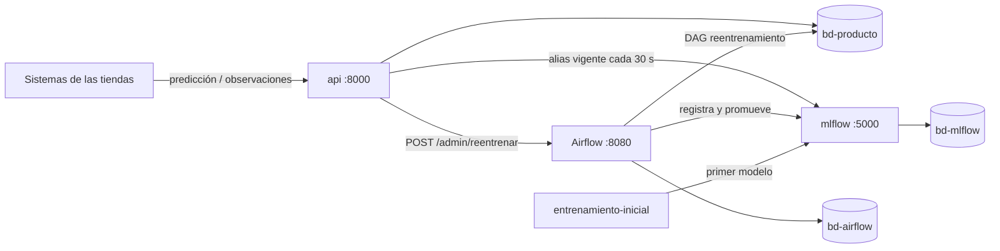

# Servicio de pronóstico de NovaMercado

Laboratorio 2 de Product Development. Servicio de ML en producción que pronostica las ventas diarias por tienda y familia de producto, con la venta esperada y la cantidad sugerida según los costos de faltante y sobrante. Se defiende de los datos defectuosos (repara, advierte o rechaza, e informa qué hizo), registra lo que predice y lo que realmente ocurre, y reentrena su modelo con Airflow y MLflow sin intervención manual.

- Decisiones técnicas y de producto, con sus alternativas: [DECISIONES.md](DECISIONES.md)
- Cada requerimiento del enunciado, dónde está y cómo se verificó: [docs/requerimientos.md](docs/requerimientos.md)
- Evidencia de funcionamiento: [docs/evidencia/](docs/evidencia/)

## Levantar el producto desde cero

Requisitos: Docker con Docker Compose (o Podman con `podman compose`), y unos 4 GB de memoria libre.

1. Clonar el repositorio.
2. **Colocar los archivos publicados en `data/publicados/`**, con sus nombres originales:

   ```
   data/publicados/
   ├── historico_ventas.csv
   ├── tiendas.csv
   ├── familias.csv
   ├── feriados.csv
   ├── costos.csv
   ├── catalogo_errores.md
   └── ejemplos/
   ```

3. Crear el archivo de credenciales, que no forma parte del repositorio (conviene cambiar las claves de ejemplo):

   ```
   cp .env.example .env
   ```

4. Levantar:

   ```
   docker compose up -d --build
   ```

5. Esperar a que el servicio esté listo. Sin contar la construcción de las imágenes, tarda de 1 a 2 minutos, mientras arranca Airflow:

   ```
   curl http://localhost:8000/health
   {"estado":"ok"}
   ```

Al levantarse desde cero no existe ningún modelo: el servicio `entrenamiento-inicial` entrena y registra el primero con los datos publicados, y la API lo carga sola. Al volver a levantarse conserva todo lo que tiene (bases, modelos y artefactos en volúmenes con nombre) y no repite ese trabajo.

Detener sin borrar nada: `docker compose down`. Borrar también los datos guardados: `docker compose down -v`.

## Uso

| Servicio | Dirección |
|---|---|
| API (contrato del Anexo) | http://localhost:8000 |
| MLflow | http://localhost:5000 |
| Airflow | http://localhost:8080 (usuario y clave: `AIRFLOW_USUARIO` y `AIRFLOW_CLAVE` del `.env`) |

| Endpoint | Qué hace |
|---|---|
| `POST /v1/prediccion` | Pronóstico de un día para una tienda: venta esperada y cantidad sugerida por familia, con `calidad` y `version_modelo` |
| `POST /v1/observaciones` | Ventas reales de un día; reenviar lo mismo responde `registros_guardados: 0` |
| `POST /admin/reentrenar` | Dispara el DAG de reentrenamiento; responde 202 con el `id` |
| `GET /admin/reentrenar/{id}` | `en_curso`, `exitoso` o `fallido`, con `promovido`, `version` y `motivo` |
| `GET /modelo` | Modelo vigente: `nombre`, `alias` y `version` |
| `GET /health` | `ok`, o `degradado` con el `motivo` si falla la base, MLflow o Airflow; 503 mientras no haya modelo |

```
curl -X POST http://localhost:8000/v1/prediccion -H "Content-Type: application/json" \
     -d @data/publicados/ejemplos/prediccion_valida.json

curl -X POST http://localhost:8000/admin/reentrenar
{"id":"manual__2026-11-16T00:00:00+00:00"}
```

Si un reentrenamiento promueve un modelo nuevo, la API lo usa en menos de 30 segundos, sin reiniciarse. Si MLflow no está disponible, la API sigue respondiendo con el modelo cargado.

## Arquitectura



## Estructura

| Carpeta | Contenido |
|---|---|
| `src/novamercado/` | El paquete: contrato, limpieza, persistencia, variables, modelo, negocio, entrenamiento, registro en MLflow, API y cliente de Airflow |
| `dags/` | El DAG de reentrenamiento (solo orquesta) |
| `tests/` | Pruebas con pytest; `datos_sinteticos.py` genera archivos publicados de prueba |
| `scripts/` | Simulación de operación y exportación de la evidencia |
| `docs/` | Lista de verificación de los requerimientos y evidencia |
| `Containerfile*`, `compose.yaml` | Imágenes y orquestación (D-010, D-011) |

## Desarrollo y pruebas

```
conda create -n lab2 python=3.12
conda activate lab2
pip install -e ".[dev]" --constraint https://raw.githubusercontent.com/apache/airflow/constraints-3.3.2/constraints-3.12.txt
pytest
```

Las pruebas no necesitan MLflow ni Airflow: MLflow corre sobre SQLite en una carpeta temporal. Las de persistencia usan un PostgreSQL si se define `NOVAMERCADO_BD_PRUEBAS_URL`; si no, se saltan. En GitHub Actions corren `pytest` (con PostgreSQL) y el workflow *Compose en Docker*, que levanta el producto con archivos sintéticos y recorre el camino del equipo docente.

## Evidencia

Con el producto levantado:

```
python scripts/simular_operacion.py   # 10 semanas de operación con un cambio de demanda
python scripts/exportar_evidencia.py  # MLflow, Airflow y respuestas de la API
```

Los resultados están en [docs/evidencia/](docs/evidencia/).
